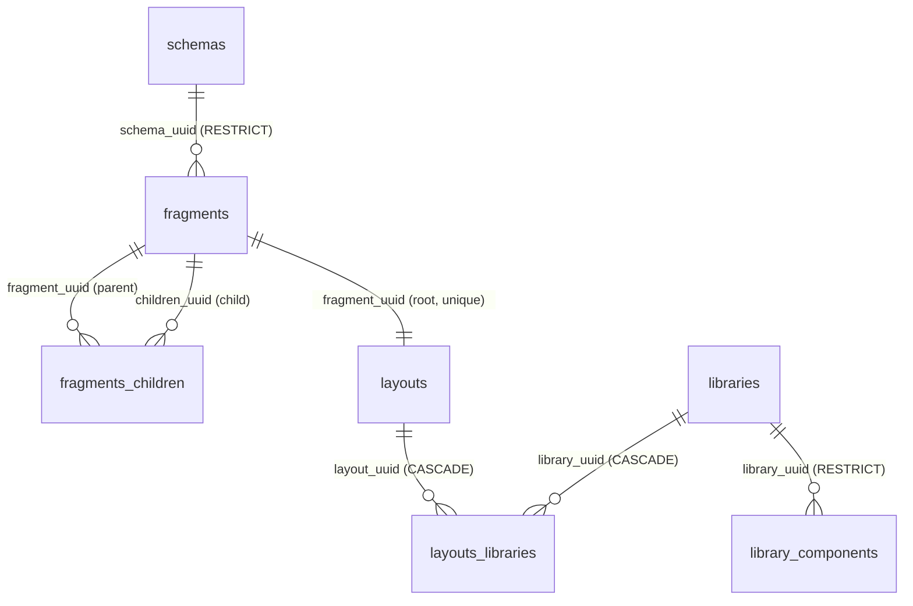

# `cms` database

The OpenThrottle CMS schema, for the [`openthrottle-cms`](../../applications/openthrottle-cms/README.md)
application. It lives on the same Postgres server as the `openthrottle` database, as a separate
database with its own [`migrations/`](./migrations/) and its own `schema_migrations` ledger. How
several databases share one runner is in [`databases/AGENTS.md`](../AGENTS.md).

| Setting           | Value                                                                                                      |
| ----------------- | ---------------------------------------------------------------------------------------------------------- |
| Database name     | `CMS_POSTGRES_DB` (default `cms`)                                                                          |
| Connection        | The primary's `POSTGRES_*` with the database swapped, or `CMS_POSTGRES_URL` if set                         |
| Created by        | Every migration entrypoint, on first run (`pnpm run database:migrate`, the dev gate, the migrations image) |
| Migrate just this | `pnpm run database:migrate -- --database cms`                                                              |
| Back up just this | `pnpm run database:backup -- --database cms` → `databases/cms/backups/cms-*.zip`                           |

## Origin

The ten starting migrations are ported from RocketCMS
(`visormatt/monorepo`, `databases/rocketcms/supabase/migrations/`), in the same order. The schema is
the same, with these changes:

- **No Supabase dependencies.** `profiles.uuid REFERENCES auth.users (id)` is gone, because there is
  no `auth` schema here. `tablespace pg_default` is dropped too.
- **Idempotent DDL** per [`ot-postgres`](../../skills/ot-postgres/SKILL.md): guarded enum types,
  `IF NOT EXISTS` tables and indexes, and foreign keys added in their own `pg_constraint`-guarded
  statement, never inline.
- **Timestamps.** `DEFAULT (now() at time zone 'utc')` on a `timestamptz` column stores the UTC
  wall-clock reinterpreted in the session time zone. It is `DEFAULT now()` here.
  `fragments_children.created_at` is `timestamptz`, like every other table.
- **Constraint names** follow Postgres's defaults (`<table>_pkey`, `<table>_<column>_fkey`,
  `<table>_<column>_key`). The source gave the `layouts` foreign key the same name as its unique
  index.
- **Comments** on every table and every non-obvious column.
- **No imported seed.** The RocketCMS `seed.sql` is a Supabase `auth.*` dump, and it is not imported.
  A small synthetic one replaces it — see [Local seed data](#local-seed-data).

## Local seed data

`pnpm run database:seed:cms` loads [`seeds/cms.sql`](./seeds/cms.sql): four ACTIVE schemas
(`Layout`, `Heading`, `Wysiwyg`, `Button`), a root `Layout` fragment with three ordered children, the
`welcome` layout rooted at it, and one library (`Sample Library`) with one component, attached to
that layout. It is synthetic — no profiles, no emails, no real people.

It is **not a migration** and is not reachable from `database:migrate`, `ensure-migrations`, setup
or any deploy path; the script refuses `NODE_ENV=production` and any Postgres host other than
`localhost`, `127.0.0.1`, `::1` or the compose service `postgres`. Every row has a fixed uuid and
every insert is `ON CONFLICT DO NOTHING`, so re-running changes nothing (and leaves your local
edits to seeded rows alone). It connects to the `cms` database the way the migration runner does,
so prefix `POSTGRES_PORT=<port>` for a worktree database, as with `database:migrate`.

CI keeps it honest: the `database-seeds` job ([`scripts/check-database-seeds.sh`](../../scripts/check-database-seeds.sh))
applies every migration to an empty Postgres, runs this seed and the blog seed twice, and fails if a
run errors, the second run changes any row, or `welcome` stops resolving by slug.

## Tables

| Table                | Purpose                                                                                   |
| -------------------- | ----------------------------------------------------------------------------------------- |
| `schemas`            | Versioned JSON Schema per `(typename, version)`, validating fragment properties           |
| `fragments`          | A named, typed piece of content; `properties` conform to its schema                       |
| `fragments_children` | Ordered parent → child edges that make fragments a tree                                   |
| `layouts`            | A publishable page addressed by `slug`, rooted at one fragment                            |
| `libraries`          | A named set of renderable components                                                      |
| `library_components` | The component that renders one `typename` within a library: its `code` and `props_schema` |
| `layouts_libraries`  | Which libraries a layout renders with                                                     |
| `profiles`           | Editor display details                                                                    |
| `surveys`            | A named survey whose definition is in `data`                                              |
| `tags`               | A tag vocabulary, not yet referenced by other tables                                      |

Every content table carries `uuid`, `created_at`, `updated_at` and a soft-delete `is_deleted`
(nullable; `NULL` reads as live). These are the `BaseUuidModel` columns of
`@openthrottle/nestjs-postgres`, which the content entities in `@openthrottle/nestjs-repositories-cms`
extend; the key and soft-delete shape stays as it is, and the library adapts to it (owner decision,
2026-11-12). The join tables `fragments_children` and `layouts_libraries` have no `is_deleted` and
stay plain entities. `updated_at` is maintained by the database (see the decision below).



`typename` ties the content side to the component side by value: `schemas.typename`,
`fragments.typename` and `library_components.typename` name the same content type, and no foreign
key enforces that.

## Decision: how `updated_at` is maintained

**A trigger, as in the `openthrottle` database** (migration `011`, OT plan `18a3b88f`). Every cms
table with an `updated_at` column (`fragments`, `layouts`, `libraries`, `library_components`,
`profiles`, `schemas`, `surveys`, `tags`) has a `BEFORE UPDATE` trigger calling the shared
`update_updated_at_column()` function, which sets it to `NOW()`.

- Why not writer-sets: TypeORM's `@UpdateDateColumn` already stamps it on every `save` and every
  `update` it builds, but raw SQL does not (the seed, ad-hoc psql fixes, the planned append-only
  schema sync), and nothing would catch a missed stamp. The trigger costs one function call per
  updated row and closes that gap. Keeping the same function name and trigger naming as the
  `openthrottle` database means one convention across both.
- The trigger always wins: an `UPDATE` that sets `updated_at` explicitly still gets `NOW()`.
  `fragments_children` and `layouts_libraries` have no `updated_at`; an edge edit stamps its
  parent fragment instead (the cms GraphQL edge mutations do).
- `created_at` stays a column default; nothing updates it.

## Decision: what identifies a CMS profile

**Profiles stand alone for now.** `profiles.uuid` is the CMS's own key. It is not an OpenThrottle
user id, because Postgres cannot declare a foreign key into another database, and the Supabase link
it replaced was exactly that kind of FK.

**Done (migration `012`, OT plan `18a3b88f`):** a profile is linked to an OpenThrottle user **by
value**: a nullable `openthrottle_user_id UUID` column with a unique index, written by the server
that holds both connections, and checked by the application rather than by the database. The
alternative, a `profiles` table in the `openthrottle` database, would put CMS data in the wrong
ledger.

- A profile is created the first time a user makes a cms write (`CmsWriteGuard` →
  `CmsProfilesService.resolveForUser`), restored if it was soft deleted, and safe under concurrent
  first writes (the unique index decides; the loser re-reads).
- `profiles.email` is NOT NULL but `users.email` is nullable, so a user without one gets
  `<user id>@openthrottle.invalid` (RFC 2606 reserved; it can never deliver).
- Service accounts write without a profile.
- Every cms mutation needs the `cms:write` permission (admin only, `openthrottle` migration `159`);
  cms reads stay public.

## Entities

The TypeORM entities for these tables live in
[`@openthrottle/nestjs-repositories-cms`](../../packages/nestjs-repositories-cms/README.md), on a
named `cms` DataSource. A schema change here is two edits: the migration and its entity.

## Decision: where the CMS API lives

Recorded by OT plan `6a17d99b-8c04-41b6-a1e1-47d812bb7658`. Points 1 and 2 were already decided
elsewhere and are written down here, not reopened. Points 3 and 4 were decided by that plan.

### 1. Placement: openthrottle-server, through the package

The CMS API lives in **openthrottle-server**. The server imports `NestjsRepositoriesCmsModule` from
[`@openthrottle/nestjs-repositories-cms`](../../packages/nestjs-repositories-cms/README.md), and the
CMS GraphQL resolvers live in that package, not in the server's own `src/`. The owner made this call
in OT plan `18a3b88f-50fe-4944-97a3-71835d45e393` ("Why a server import, not the CMS app").

- [`openthrottle-cms`](../../applications/openthrottle-cms/README.md) is a React Router client. It
  reads the committed `applications/openthrottle-server/schema.gql` like every other consumer, and
  it has no database connection of its own.
- If a dedicated CMS server is ever split out, it imports the same module unchanged. Keeping the
  resolvers in the package is what keeps that move cheap.

### 2. Connection: the named `CMS_CONNECTION` DataSource

The module registers a TypeORM DataSource named `CMS_CONNECTION`. Its URL comes from
`getCmsPostgresUrl` in
[`packages/openthrottle-agentic-utils/src/utils/postgres.ts`](../../packages/openthrottle-agentic-utils/src/utils/postgres.ts),
which resolves in the same order as the `cms` entry in
[`databases/database-registry.ts`](../database-registry.ts):

1. `CMS_POSTGRES_URL`, when it is set.
2. Otherwise the primary's `POSTGRES_*` settings, with the database swapped for `CMS_POSTGRES_DB`
   (default `cms`).

`getCmsPostgresUrl` returns a result type, and the module throws when the result is a failure. A
server that imports the module but cannot resolve a URL fails at boot, rather than starting and
failing on the first CMS query.

### 3. Schema sync trigger: on server boot, in the package, plus an admin mutation

The sync that fills `schemas` from the block manifests (OT plan
`a608869b-407d-40a0-9dff-8d61fe578cf7`, task 5) runs in two places. Both are in
`@openthrottle/nestjs-repositories-cms`:

- An **`onApplicationBootstrap` hook** in the module. It runs once each time the server starts.
- An **admin-only `syncCmsSchemas` mutation**. It runs the same code on demand, and it is how you
  retry after a failed boot sync.

It is not a step in `monorepo:ensure-migrations`. That gate is a pre-boot `tsx` script that runs only
on the host `dev` path. In production, migrations run from the separate `Dockerfile.Migrations` image,
which copies only `databases/` and has no block packages. A script step would need two homes and a
copy of the manifests in the migrations image. The boot hook runs wherever the server runs (dev, a
worktree, the production image), and it uses the `CMS_CONNECTION` and entities the module already
has.

What the sync has to guarantee:

- **Append-only.** A `(typename, version)` missing from the table inserts one row. Nothing is updated
  or deleted, and fragments keep the `schema_uuid` they were created with.
- **Safe with more than one replica.** Today `(typename, version)` has only a plain index
  (`idx_schemas_typename_version`, migration 001), so two servers booting together could insert the
  same row twice. Task 5 adds a migration that makes the pair unique, and the sync inserts with
  `ON CONFLICT (typename, version) DO NOTHING`.
- **Never blocks the API.** A failed sync logs an error and the server keeps serving. Fragment writes
  against a typename with no row then fail on their own, and the rest of OpenThrottle stays up.

### 4. How the server reads the manifests: copied into the package's `dist/` at build time

The manifests are committed under `packages/react-router-cms-ui/schemas/` and
`packages/react-router-cms-core/schemas/` (`manifest.json` plus `<Typename>.schema.json`, written by
`cms-schemas:write`). The server reads them as **JSON files**, never through those packages'
source-first TypeScript entries.

**Decision:** the `build` target of `@openthrottle/nestjs-repositories-cms` copies both folders into
its own output, using the `@nx/js:tsc` `assets` option (the
[package generator template](../../tools/generators/src/generators/package/files/tools/package.json)
already uses it):

```text
packages/react-router-cms-ui/schemas/*.json   → packages/nestjs-repositories-cms/dist/schemas/react-router-cms-ui/
packages/react-router-cms-core/schemas/*.json → packages/nestjs-repositories-cms/dist/schemas/react-router-cms-core/
```

At runtime the sync finds them relative to its own compiled file, with
`new URL('…/schemas/', import.meta.url)`. It never uses a path from the repository root and never
resolves either React package. The build's `inputs` name both `schemas/` folders, so editing a block
schema invalidates the Nx cache and the copy cannot go stale.

Why this survives the production image: `Dockerfile.NestJS` builds every package, then ships only the
`pnpm --filter openthrottle-server --prod deploy` tree. The server resolves
`@openthrottle/nestjs-repositories-cms` through its `exports`, which point at `dist/`. Once the
server imports the module (plan `18a3b88f`), that `dist/` must be in the image or the server cannot
boot, so the manifests ride inside a directory the image already has to ship.
[`boot-check.sh`](../../.github/actions/docker-build-push/boot-check.sh) boots that image with a
read-only root before it is pushed, so a missing folder shows up there as a logged sync error.

In dev, `openthrottle-server:dev` runs `^build` first, so the copy exists before the server starts.
After `cms-schemas:write`, rebuild the package (or restart `dev`) and run `syncCmsSchemas`.

Rejected options:

- **Resolve the React packages at runtime** (`require.resolve` of their `package.json`). The server
  would need both packages as **production** dependencies. `pnpm deploy` would then put their whole
  React tree (react, react-router, the shadcn package, lucide, jotai, react-dnd) into the server
  image, all to read a few JSON files.
- **An `exports` subpath `./schemas/*`** on the React packages. Same dependency problem, and it adds
  a server-facing entry to client packages whose entries deliberately point at `src`.

## Not here yet

Reads and writes are served: `openthrottle-server` imports `NestjsRepositoriesCmsModule`, whose
`CmsGraphqlModule` answers `cmsLayout` / `cmsLayoutByUuid` (the fragment tree in one recursive query,
cut at depth 10, cycles not followed), `cmsLayouts`, `cmsLibraries`, `cmsSchemas`, `cmsSchema` and
`cmsSchemaByTypename`. Reads are public; writes (fragments and their edges, layouts, library
components) need `cms:write`. What is left:

- **Filling `schemas`** (OT plan `a608869b-407d-40a0-9dff-8d61fe578cf7`, task 5), as decided in
  [§ 3](#3-schema-sync-trigger-on-server-boot-in-the-package-plus-an-admin-mutation) and
  [§ 4](#4-how-the-server-reads-the-manifests-copied-into-the-packages-dist-at-build-time).
