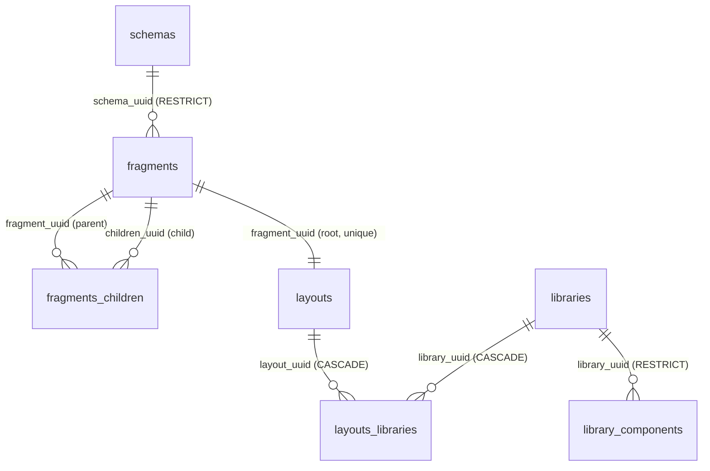

# `cms` database

The OpenThrottle CMS schema, for the [`openthrottle-cms`](../../applications/openthrottle-cms/README.md)
application. It lives on the same Postgres server as the `openthrottle` database, as a separate
database with its own [`migrations/`](./migrations/) and its own `schema_migrations` ledger. How
several databases share one runner is in [`databases/AGENTS.md`](../AGENTS.md).

| Setting           | Value                                                                                                      |
| ----------------- | ---------------------------------------------------------------------------------------------------------- |
| Database name     | `CMS_POSTGRES_DB` (default `cms`)                                                                          |
| Connection        | The primary's `POSTGRES_*` with the database swapped, or `CMS_POSTGRES_URL` if set                         |
| Created by        | Every migration entrypoint, on first run (`pnpm run database:migrate`, the dev gate, the migrations image) |
| Migrate just this | `pnpm run database:migrate -- --database cms`                                                              |
| Back up just this | `pnpm run database:backup -- --database cms` → `databases/cms/backups/cms-*.zip`                           |

## Origin

The ten starting migrations are ported from RocketCMS
(`visormatt/monorepo`, `databases/rocketcms/supabase/migrations/`), in the same order. The schema is
the same, with these changes:

- **No Supabase dependencies.** `profiles.uuid REFERENCES auth.users (id)` is gone, because there is
  no `auth` schema here. `tablespace pg_default` is dropped too.
- **Idempotent DDL** per [`ot-postgres`](../../skills/ot-postgres/SKILL.md): guarded enum types,
  `IF NOT EXISTS` tables and indexes, and foreign keys added in their own `pg_constraint`-guarded
  statement, never inline.
- **Timestamps.** `DEFAULT (now() at time zone 'utc')` on a `timestamptz` column stores the UTC
  wall-clock reinterpreted in the session time zone. It is `DEFAULT now()` here.
  `fragments_children.created_at` is `timestamptz`, like every other table.
- **Constraint names** follow Postgres's defaults (`<table>_pkey`, `<table>_<column>_fkey`,
  `<table>_<column>_key`). The source gave the `layouts` foreign key the same name as its unique
  index.
- **Comments** on every table and every non-obvious column.
- **No imported seed.** The RocketCMS `seed.sql` is a Supabase `auth.*` dump, and it is not imported.
  A small synthetic one replaces it — see [Local seed data](#local-seed-data).

## Local seed data

`pnpm run database:seed:cms` loads [`seeds/cms.sql`](./seeds/cms.sql): four ACTIVE schemas
(`Layout`, `Heading`, `Wysiwyg`, `Button`), a root `Layout` fragment with three ordered children, the
`welcome` layout rooted at it, and one library (`Sample Library`) with one component, attached to
that layout. It is synthetic — no profiles, no emails, no real people.

It is **not a migration** and is not reachable from `database:migrate`, `ensure-migrations`, setup
or any deploy path; the script refuses `NODE_ENV=production` and any Postgres host other than
`localhost`, `127.0.0.1`, `::1` or the compose service `postgres`. Every row has a fixed uuid and
every insert is `ON CONFLICT DO NOTHING`, so re-running changes nothing (and leaves your local
edits to seeded rows alone). It connects to the `cms` database the way the migration runner does,
so prefix `POSTGRES_PORT=<port>` for a worktree database, as with `database:migrate`.

CI keeps it honest: the `database-seeds` job ([`scripts/check-database-seeds.sh`](../../scripts/check-database-seeds.sh))
applies every migration to an empty Postgres, runs this seed and the blog seed twice, and fails if a
run errors, the second run changes any row, or `welcome` stops resolving by slug.

## Tables

| Table                | Purpose                                                                                   |
| -------------------- | ----------------------------------------------------------------------------------------- |
| `schemas`            | Versioned JSON Schema per `(typename, version)`, validating fragment properties           |
| `fragments`          | A named, typed piece of content; `properties` conform to its schema                       |
| `fragments_children` | Ordered parent → child edges that make fragments a tree                                   |
| `layouts`            | A publishable page addressed by `slug`, rooted at one fragment                            |
| `libraries`          | A named set of renderable components                                                      |
| `library_components` | The component that renders one `typename` within a library: its `code` and `props_schema` |
| `layouts_libraries`  | Which libraries a layout renders with                                                     |
| `profiles`           | Editor display details                                                                    |
| `surveys`            | A named survey whose definition is in `data`                                              |
| `tags`               | A tag vocabulary, not yet referenced by other tables                                      |

Every content table carries `uuid`, `created_at`, `updated_at` and a soft-delete `is_deleted`.
Nothing maintains `updated_at` yet: there is no trigger, so the writer sets it.

`typename` ties the content side to the component side by value: `schemas.typename`,
`fragments.typename` and `library_components.typename` name the same content type, and no foreign
key enforces that.

## Decision: what identifies a CMS profile

**Profiles stand alone for now.** `profiles.uuid` is the CMS's own key. It is not an OpenThrottle
user id, because Postgres cannot declare a foreign key into another database, and the Supabase link
it replaced was exactly that kind of FK.

When the CMS gets authentication, the plan is to link a profile to an OpenThrottle user **by value**:
a nullable `openthrottle_user_id UUID` column with a unique index, written by the server that holds
both connections, and checked by the application rather than by the database. The alternative, a
`profiles` table in the `openthrottle` database, would put CMS data in the wrong ledger. That work is
a follow-up OT plan, not part of this schema.

## Entities

The TypeORM entities for these tables live in
[`@openthrottle/nestjs-repositories-cms`](../../packages/nestjs-repositories-cms/README.md), on a
named `cms` DataSource. A schema change here is two edits: the migration and its entity.

## Not here yet

Tracked in OT plan `18a3b88f-50fe-4944-97a3-71835d45e393`:

- GraphQL for these tables, and wiring the entities into an app. Nothing in the server reads them
  yet.
- Filling `schemas` (OT plan `a608869b-407d-40a0-9dff-8d61fe578cf7`, task 5). The rows come from
  the block JSON Schemas committed under `packages/react-router-cms-ui/schemas/` and
  `packages/react-router-cms-core/schemas/`, where each `manifest.json` gives every block's
  `typename` and a content-hash `version`. The sync is append-only by design: a new
  `(typename, version)` inserts a row, nothing is updated or deleted, and fragments keep the
  `schema_uuid` they were created with.
- Seed data for local development.
